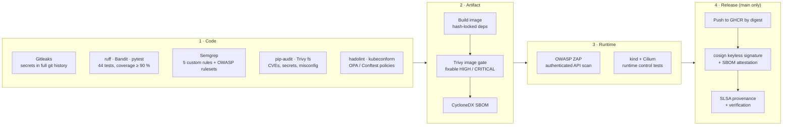

# ShieldPipe

[](https://github.com/Barkatzineddine/shieldpipe/actions/workflows/devsecops.yml)
[](https://github.com/Barkatzineddine/shieldpipe/actions/workflows/codeql.yml)
[](https://scorecard.dev/viewer/?uri=github.com/Barkatzineddine/shieldpipe)
[](LICENSE)

**A DevSecOps reference pipeline.** A security-hardened incident API for a SOC team only reaches
production after passing every gate: secrets, SAST, dependencies, infrastructure policy, image
scanning, authenticated DAST, and a real Kubernetes deployment where the network and container
controls are attacked and verified. The released image is signed without keys, ships with an SBOM
and carries SLSA provenance.

The API is deliberately small. The point of the project is the delivery chain around it and the
evidence that each control works.

## Pipeline



Every job uploads its findings as SARIF to the repository's **Security** tab, so results from
seven different tools are triaged in one place.

| Stage | Tool | The build fails when |
|---|---|---|
| Secrets | Gitleaks | a credential appears anywhere in the git history |
| Quality | ruff, pytest | lint or formatting errors, a failing test, coverage below 90 % |
| SAST | Bandit, Semgrep, CodeQL | a security finding in the code, or a custom rule's own test fails |
| Dependencies | pip-audit, Trivy fs | a known vulnerability in a runtime dependency; a HIGH/CRITICAL misconfiguration or secret |
| Infrastructure | hadolint, kubeconform, Conftest | Dockerfile issues, invalid manifests, or a broken policy (root user, `latest` tag, missing limits...) |
| Image | Trivy | a fixable HIGH or CRITICAL CVE in the built image |
| DAST | OWASP ZAP | injection, XSS or a missing security header found on the running API |
| Runtime | kind + Cilium + `scripts/e2e.sh` | any of the runtime controls below does not hold |
| Release | cosign, GitHub attestations | the signature or SBOM attestation cannot be verified |

## Runtime controls, proven on a live cluster

The `k8s-e2e` job creates a kind cluster with Cilium as CNI, deploys the exact image that was
scanned, then tries to break each control. The job summary lists the result of every check.

| Control | How it is tested |
|---|---|
| Cilium L3/L4 policy | a pod without the `access: shieldpipe` label cannot open a connection |
| Cilium L7 HTTP allow-list | `GET /openapi.json` and `PUT /api/v1/users` are refused with 403 by Envoy before reaching the app |
| No egress | the API pod cannot open an outbound connection (no exfiltration, no reverse shell) |
| Non-root | the process runs as UID 10001 |
| Read-only root filesystem | writing to `/app` fails |
| No Kubernetes credentials | no service account token is mounted |
| Pod Security Admission | the API server rejects a privileged pod in the namespace |
| End-to-end auth | a labelled client logs in through the L7 proxy and calls the API |

## Application security

| Area | Implementation |
|---|---|
| Passwords | Argon2id, 12 to 128 characters, must not contain the username |
| Tokens | HS256 only; `iss`, `aud`, `exp`, `nbf`, `jti` required; 15-minute lifetime; role re-read from the database |
| Brute force | sliding-window throttling per account and per source IP, with `Retry-After` |
| Access control | analysts only see their own incidents (404 otherwise, so IDs cannot be probed); admin-only deletion and user management |
| Input | strict Pydantic models reject unknown fields (no mass assignment); bound SQL parameters; escaped `LIKE` |
| Transport and browser | CSP `default-src 'none'`, HSTS, `nosniff`, `DENY` framing, `no-store`, no `Server` header |
| Abuse | 64 KB body cap enforced at the ASGI layer, also for chunked bodies; paginated lists capped at 100 |
| Audit | one JSON event per security-relevant action (actor, source IP, request ID, outcome), ready for a SIEM such as Wazuh |
| Configuration | refuses to start without a JWT secret of at least 32 characters; API docs disabled by default |

The [threat model](docs/threat-model.md) maps each threat to its mitigation and to the test that
proves it. [Security controls](docs/security-controls.md) maps the project to the OWASP Top 10,
NIST SSDF and SLSA.

## Supply chain

- **Pinned everything.** GitHub Actions by full commit SHA, base and tool images by digest, Python
  dependencies by hash (`pip install --require-hashes`). Dependabot proposes the updates.
- **Least privilege CI.** Read-only `GITHUB_TOKEN` by default, extra permissions per job only,
  `persist-credentials: false` on every checkout.
- **Signed releases.** No long-lived signing key: cosign uses the workflow's OIDC identity through
  Sigstore. Anyone can verify an image came from this repository's `main` branch:

```bash
cosign verify ghcr.io/barkatzineddine/shieldpipe@<digest> \
  --certificate-identity https://github.com/Barkatzineddine/shieldpipe/.github/workflows/devsecops.yml@refs/heads/main \
  --certificate-oidc-issuer https://token.actions.githubusercontent.com

gh attestation verify oci://ghcr.io/barkatzineddine/shieldpipe@<digest> --owner Barkatzineddine
```

## Policy as code

Rules live in [`policy/`](policy) and have their own unit tests (`conftest verify`). They block, for
example: containers running as root, privilege escalation, missing `drop: [ALL]`, writable root
filesystems, `latest` or untagged images, missing resource limits or probes, host namespaces and
`hostPath` volumes, namespaces without the restricted Pod Security profile, public `NodePort` or
`LoadBalancer` services, unpinned base images, `ADD`, and `curl | sh` in the Dockerfile.

Custom Semgrep rules in [`.semgrep/`](.semgrep) target this codebase's real risks (SQL built from
strings, `jwt.decode` without fixed algorithms, disabled signature checks, credentials in logs,
FastAPI debug mode) and are tested against fixtures before every scan.

## Run it locally

```bash
python -m venv .venv && source .venv/bin/activate
pip install --require-hashes --no-deps -r requirements-dev.txt
pytest                      # 44 tests, unit + security
ruff check . && bandit -c pyproject.toml -r app
```

With Docker:

```bash
docker build -t shieldpipe:local .
docker run --rm -p 8000:8000 --read-only --tmpfs /tmp \
  --tmpfs /app/data:uid=10001,gid=10001 --cap-drop ALL --security-opt no-new-privileges \
  -e SHIELDPIPE_JWT_SECRET="$(openssl rand -hex 32)" \
  -e SHIELDPIPE_BOOTSTRAP_ADMIN_USERNAME=admin \
  -e SHIELDPIPE_BOOTSTRAP_ADMIN_PASSWORD='choose-a-long-passphrase' \
  shieldpipe:local
```

On Kubernetes with Cilium, follow [`scripts/e2e.sh`](scripts/e2e.sh), which is what CI runs.

## API

| Method | Path | Who |
|---|---|---|
| `POST` | `/api/v1/auth/login` | anyone (throttled) |
| `GET` | `/api/v1/auth/me` | authenticated |
| `GET`, `POST` | `/api/v1/incidents` | authenticated (own incidents; admins see all) |
| `GET`, `PATCH` | `/api/v1/incidents/{id}` | owner or admin |
| `DELETE` | `/api/v1/incidents/{id}` | admin |
| `GET`, `POST` | `/api/v1/users` | admin |
| `GET` | `/healthz`, `/readyz` | probes |

## Repository layout

```
app/                 FastAPI service (auth, RBAC, throttling, audit, middleware)
tests/               functional and security regression tests
policy/              OPA / Conftest rules for Kubernetes and Docker, with tests
.semgrep/            custom SAST rules and their test fixtures
deploy/k8s/          hardened manifests, NetworkPolicy, Cilium L7 policy (kustomize)
deploy/kind/         CI cluster definition (Cilium as CNI)
scripts/e2e.sh       runtime security checks against a live cluster
.github/workflows/   DevSecOps pipeline, CodeQL, OpenSSF Scorecard
docs/                threat model and framework mapping
```

## Known limits

Single replica (SQLite and in-memory throttling), no token revocation before expiry, no MFA, and
image signatures are verified in CI but not yet enforced at admission. The
[threat model](docs/threat-model.md#residual-risks-and-next-steps) explains each one and the planned fix.

## Author

Mohamed Zineddine Barkat, Master's student in Systems Design and Cybersecurity (Université
Paris-Est Créteil). [Portfolio](https://barkatzineddine.github.io) ·
[LinkedIn](https://www.linkedin.com/in/mohamed-zineddine-barkat/)
