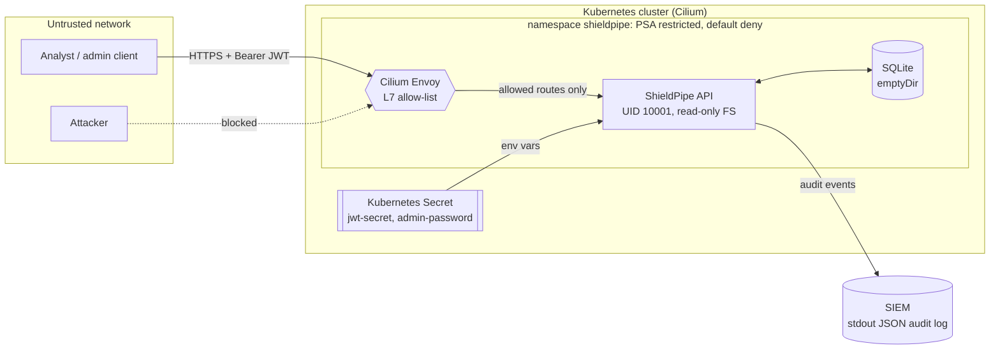

# Threat model

Method: STRIDE per element, on the data-flow diagram below. Every mitigation points to the code
or pipeline step that implements it and, where possible, to the test that proves it.

## System

ShieldPipe is an incident-tracking API for a small SOC team. Analysts record and update security
incidents; administrators manage accounts and can delete incidents. It runs as a single container
on Kubernetes behind a ClusterIP service.

Trust boundaries: network to cluster (Cilium policy), proxy to application (authentication),
application to data (authorisation per record), CI to registry (signing).

## Assets

| Asset | Why it matters |
|---|---|
| Incident records | Describe attacks in progress and weaknesses of the organisation |
| User credentials | Argon2id hashes; a leak enables offline cracking |
| JWT signing secret | Whoever holds it can mint admin tokens |
| Container image | A tampered image is code execution in the cluster |
| Audit trail | Needed to investigate misuse of the tool itself |

## STRIDE analysis

| ID | Threat | Mitigation | Verified by |
|---|---|---|---|
| S1 | Password guessing / credential stuffing | Argon2id hashes; per-account (5 / 5 min) and per-IP (20 / 5 min) throttling with `Retry-After` | `test_brute_force_is_throttled`, `test_password_spraying_is_throttled_per_ip` |
| S2 | Forged or replayed token (`alg: none`, wrong key, expired, other audience) | HS256 only, issuer, audience, `exp`, `nbf`, `jti` all required; 15-minute lifetime; role read from the database on each request | `test_invalid_tokens_are_rejected` (9 cases) |
| S3 | User enumeration through login | Identical error for unknown users and wrong passwords; dummy hash keeps timing similar | `test_login_does_not_reveal_whether_a_user_exists` |
| S4 | Weak passwords | 12 to 128 characters, must not contain the username (NIST SP 800-63B) | `test_password_policy` |
| T1 | SQL injection | ORM expressions with bound parameters; `LIKE` wildcards escaped; custom Semgrep rule bans string-built SQL | `test_search_is_not_injectable`, Semgrep `sql-built-from-string`, ZAP rules 40018/40024 |
| T2 | Mass assignment (`owner_id`, `role`) | Pydantic models with `extra="forbid"`; owner always set server-side | `test_mass_assignment_is_rejected` |
| T3 | Stored XSS in incident titles | JSON-only responses, `Content-Security-Policy: default-src 'none'`, `nosniff` | `test_stored_xss_payload_is_returned_as_inert_json`, ZAP 40012/40014 |
| R1 | A user denies an action | JSON audit events with actor, source IP, request ID and outcome for logins, token failures, access denials and every write | `test_security_events_are_audited`, DAST job checks the log |
| I1 | Reading another analyst's incident (IDOR) | Ownership filter in every query; 404 for records the caller cannot see, so IDs cannot be probed | `test_analyst_cannot_read_or_edit_another_analysts_incident` |
| I2 | Leaking internals through errors or docs | Generic 500 handler; OpenAPI and docs disabled unless explicitly enabled; no `Server` header | `test_unhandled_errors_do_not_leak_details`, `test_openapi_and_docs_hidden_by_default` |
| I3 | Secrets in source code or git history | Gitleaks over full history; Trivy secret scanner; config only from environment, no default JWT secret | Pipeline jobs `secrets` and `sca` |
| I4 | Secrets in logs | Audit helper never receives credentials; Semgrep rule `secret-written-to-logs` | `test_security_events_are_audited` asserts the password is absent |
| D1 | Large or endless request bodies | 64 KB cap enforced at ASGI level, including chunked bodies without `Content-Length` | `test_oversized_body_is_rejected`, `test_oversized_streamed_body_is_rejected` |
| D2 | Expensive listing queries | Page size capped at 100, offset at 10,000 | `test_pagination_is_capped` |
| D3 | Resource exhaustion on the node | CPU and memory requests and limits, `emptyDir` size limits; enforced by OPA policy | Conftest `kubernetes.rego` |
| E1 | Analyst calls admin endpoints | `require_admin` dependency on user management and deletion | `test_analyst_cannot_use_admin_endpoints` |
| E2 | Container breakout after an RCE | Non-root UID, no privilege escalation, all capabilities dropped, seccomp `RuntimeDefault`, read-only root FS, no service account token, Pod Security `restricted` | Conftest policies; e2e checks UID, read-only FS, token absence, PSA rejection |
| E3 | Lateral movement and exfiltration from a compromised pod | Default-deny ingress and egress; Cilium L7 allow-list; the API has no egress at all | e2e: unlabelled pod dropped, undeclared routes get 403, outbound connection blocked |

## Supply chain threats

| ID | Threat | Mitigation |
|---|---|---|
| SC1 | Malicious or vulnerable dependency | Hash-locked requirements (`--require-hashes`), pip-audit and Trivy gates, Dependabot |
| SC2 | Compromised GitHub Action (tag moved to malicious code) | Every action pinned to a full commit SHA; workflow tokens read-only by default; `persist-credentials: false` |
| SC3 | Compromised base image or tool image | Base and scanner images pinned by digest; Trivy image gate on fixable HIGH and CRITICAL |
| SC4 | Image swapped in the registry | Keyless cosign signature bound to this workflow's identity, CycloneDX SBOM attestation, SLSA build provenance, all verified right after publishing |
| SC5 | Insecure change merged | Branch protection with required checks, CODEOWNERS, CodeQL and OpenSSF Scorecard |

## Residual risks and next steps

- **Token revocation.** Tokens stay valid until they expire (15 minutes). A deny-list keyed on
  `jti` in Redis would allow immediate logout.
- **Shared signing secret.** HS256 means the API both signs and verifies. With several services,
  move to asymmetric keys (EdDSA) published as a JWKS.
- **Single replica.** SQLite and the in-memory throttle are per-process. Scaling out requires
  PostgreSQL and a shared rate-limit store.
- **No MFA.** Accounts rely on passwords only; TOTP or WebAuthn is the next control to add.
- **Admission-time signature checks.** The cluster does not yet refuse unsigned images. A Kyverno
  or Sigstore policy-controller rule verifying the cosign identity would close SC4 at deploy time.
- **Secrets management.** CI creates the Kubernetes Secret directly. Production should use
  External Secrets or Sealed Secrets, with etcd encryption at rest.
